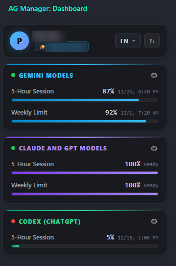
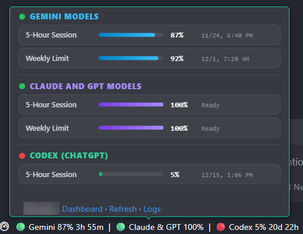

# AG Manager (Antigravity-Codex-Claude Monitor)

**AG Manager** is a lightweight VS Code and **Antigravity IDE** extension for monitoring AI usage quotas across **Antigravity** (Gemini, Claude, GPT), **Claude (OAuth)**, and **OpenAI Codex (ChatGPT)** in real time.

## 📸 Previews

| Dashboard | Status Bar Popup |
|-----------|------------------|
|  |  |

## 🚀 Key Features

- **Antigravity IDE 2.6.0+ (`agy --hub`) Support:** Automatically discovers local Antigravity server sessions via hub daemon files and process scanning, and dynamically groups models by shared quota pools without hardcoded version names.
- **Multi-Service Quota Tracking:** Monitors 5-hour session and weekly limits across Antigravity shared quota groups, official **Claude (OAuth)** accounts, and **OpenAI Codex (ChatGPT)** local sessions.
- **Real-Time Status Bar Countdowns:** Displays live countdown timers (`Xd Xh`, `Xh Xm`, `Xm Xs`) alongside remaining percentages for each visible group and automatically refreshes when a reset timer expires.
- **Antigravity 2.0+ Dark UI & Semantic Health Indicators:** Features a matte-dark Bento Dashboard, a seamless single-card hover popup, brand-colored group headings and HP bars, and semantic health dots (`51–100%` green, `21–50%` yellow, `0–20%` red).
- **Custom Dark `EN`/`VI` Switcher & Visibility Toggles:** Switch between English and Vietnamese via a dark-themed dropdown menu and toggle individual groups on or off in the Status Bar.
- **Smart Alerts & Diagnostics:** Sends group-level low-quota warnings (<= 20%) that auto-reset after recovery, runs configurable background auto-refresh, and logs connection diagnostics to the `AG Manager` Output Channel.

## ⌨️ Commands

- `sqm.openDashboard` — **AG Manager: Open Dashboard**
- `sqm.refresh` — **AG Manager: Refresh Quotas**
- `sqm.showLogs` — **AG Manager: Show Output Logs**

## 🛠 Settings

- `sqm.refreshInterval`: Auto-refresh interval in minutes (Default: `5`; options: `1`, `2`, `5`, `10`, `15`, `30`).
- `sqm.enableNotifications`: Enable low-quota notifications (Default: `true`).

---
*Developed by BiViPi — Built for Antigravity IDE workflows.*
